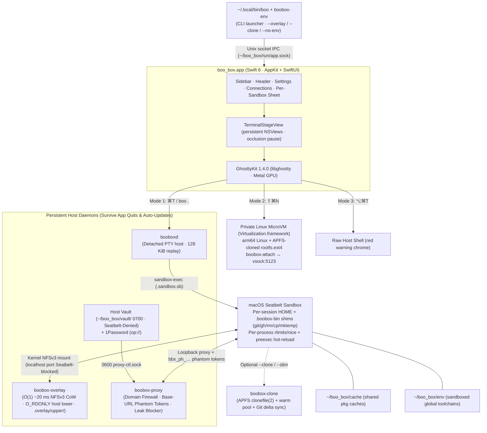
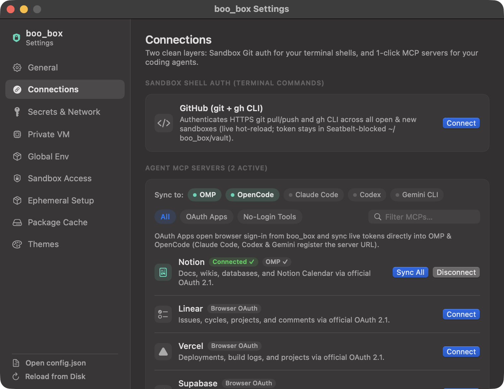

# boo_box — Sandboxed macOS Terminal for AI Coding Agents

**`boo_box`** is an open-source, native macOS **sandbox terminal** built on **Ghostty (`libghostty` / `GhosttyKit`)** that runs every tab behind kernel-enforced **AI agent guardrails**. Built for safely running autonomous coding agents — including **Claude Code**, **OpenAI Codex**, **OpenCode**, **Gemini CLI**, and **OMP** — as well as untrusted builds and scripts without exposing your Mac, personal files, real git checkouts, or API keys.

Every workspace opens in **`~20 ms`** via an $O(1)$ Copy-on-Write overlay (`boobox-overlay`) inside a default-deny **macOS Seatbelt** (`sandbox-exec`) sandbox or an ephemeral **Apple Silicon Linux microVM** (`Virtualization.framework`), protected by a host-side **egress firewall & phantom-token secret vault** (`boobox-proxy`).

<p align="center">
  
</p>

---

## Why Use a Sandboxed Terminal for AI Coding Agents?

Running autonomous coding agents directly in an unsandboxed terminal gives prompt-injected or misbehaving agents full read/write access to `~/Desktop`, `~/Documents`, `~/.ssh`, macOS Keychain, your real Git repositories, local databases, and raw LLM/cloud API keys.

`boo_box` provides **local, zero-Docker agent guardrails** at native Ghostty Metal GPU speed:
- **Three execution modes in one terminal:**
  1. **macOS Sandbox (default, `⌘T` / `boo .`):** Kernel-enforced macOS Seatbelt (`sandbox-exec`) with a per-session `$HOME` (`~/boo_box/sessions/<id>/`) and **~20 ms $O(1)$ Instant CoW Overlay** (`boobox-overlay`) — or optional APFS `clonefile(2)` snapshot (`boobox-clone`). Agents can edit or `rm -rf` freely without ever modifying your real repo or host files.
  2. **Private Linux MicroVM (`⇧⌘N`):** Ephemeral Apple Silicon `arm64` Linux microVM via Apple's `Virtualization.framework` (`vmlinux-arm64` + APFS-cloned Alpine `rootfs.ext4`, 1-slot warm VM pool, multi-PTY over `vsock` via `boobox-attach`). Zero Mac filesystem access by default; wiped on close.
  3. **Raw Host Shell (`⌥⌘T`):** Explicit unsandboxed escape hatch with an unmistakable red warning header.
- **Seatbelt-Denied Host Vault & Egress Proxy Sidecar (`boobox-proxy`):**
  - Real API keys, GitHub tokens, and OAuth credentials stay **only on the host** in the Seatbelt-denied **Host Vault** (`~/boo_box/vault/`, `0700`/`0600`, zero Keychain ACL prompts across rebuilds/updates) or **1Password (`op://`)** — never written to `config.json` or sandbox files.
  - Sandboxes only receive worthless phantom tokens (`bbx_ph_...`) and Base-URL routes swapped at `boobox-proxy` strictly for bound hosts, with response scrubbing and active exfiltration blocking (`403 leak_blocked`).
  - Three outbound network policies (`Full (Vault Protected)`, `Dev Allowlist`, `Offline (Air-gapped)`), enforced at the kernel level via Seatbelt + direct DNS (`/var/run/mDNSResponder`) blocking.
- **Per-Sandbox Overrides (`⌥⌘,` or sidebar `…` popup):** Override network policy, Vault secret subsets, env vars, shared toolchains, host capabilities, per-process kernel `rlimit` / `nice` caps, and Private VM vCPU / RAM / NAT-or-Offline / VirtioFS `/mnt/host` shares individually per session.
- **Global Sandbox Environment (`~/boo_box/env`):** Run arbitrary install scripts (`curl … | sh`, `npm i -g`, `bun add -g`, `uv tool install`, `go install`, `cargo install`, etc.) inside Seatbelt targeting `~/boo_box/env`, with automatic executable directory discovery added to sandbox `PATH` across all sessions.
- **O(1) Instant CoW Overlay (`boobox-overlay`) & Zero-Hang Lifecycle:**
  - Default workspace engine (`boobox-overlay`) mounts any folder — even multi-million-file monorepos or multi-repo directories — in **`~20 ms`** via unprivileged localhost NFSv3 Copy-on-Write (`O_RDONLY | O_NOFOLLOW` host lower layer + isolated `.overlay/upper/` + whiteouts, pipelined TCP RPCs, `READDIR` caching, Git `core.checkStat=minimal`, Seatbelt-blocked localhost port, 128-bit HMAC handles, zero `sudo`/kexts).
  - Optional **APFS Full Clone** (`--clone` / `--full` / `--slim`, or in `Settings → General`) uses `boobox-clone` + kernel `clonefile(2)` + warm pool + Git delta sync for a frozen point-in-time snapshot.
  - Persistent detached PTYs (`booboxd`) keep running shells and coding agents alive across app quits and auto-updates, with 128 KiB scrollback replay on reattach.
  - Deleting saved/active sessions and running `rm -rf <dir>` inside sandboxes both use atomic move-aside + detached background reaping (`<5 ms`).

## How `boo_box` Compares to Other Agent Sandboxes

| Capability | Raw Terminal (iTerm2 / Ghostty) | Docker / Devcontainers | Cloud Agent Sandboxes | **`boo_box` (macOS Sandbox / MicroVM)** |
|---|---|---|---|---|
| **Workspace startup (350k-file monorepo)** | Instant *(no isolation)* | 5–60+ s image/bind mount | 10–60 s remote VM | **`~20 ms` $O(1)$ CoW Overlay** *(or ~250 ms warm Linux microVM)* |
| **Protects host files (`~/Desktop`, `~/.ssh`, real repos)** | No | Partial *(bind mounts often RW)* | Yes *(remote)* | **Yes — kernel Seatbelt default-deny + `O_RDONLY` host lower layer** |
| **Safe `rm -rf` / untrusted scripts** | Destructive on host | Inside container | Remote | **Isolated in `.overlay/upper/` or ephemeral microVM; host untouched** |
| **API key & secret exfiltration guardrails** | Raw keys in env | Raw keys in env | Remote env | **Host-only Vault + `bbx_ph_…` phantom tokens + `403 leak_blocked`** |
| **Outbound domain firewall & air-gapped offline mode** | No | Manual iptables | Varies | **Built-in (`Full` / `Dev Allowlist` / `Offline` + Seatbelt DNS lock)** |
| **Native macOS toolchains & GPU Ghostty terminal** | Yes | Linux-only container | Web/SSH only | **Yes — native macOS Metal Ghostty + optional Linux microVM** |
| **Works offline / zero cloud lock-in** | Yes | Yes | No | **100% local on Apple Silicon** |


## First-Time Setup (Recommended: Let Your Agent Do It)

Because `boo_box` runs every tab inside a strict macOS Seatbelt sandbox (kernel-blocking macOS Keychain, `~/.ssh`, host `/opt/homebrew` writes, and files outside your cloned workspace), there is a bit of one-time setup to wire your GitHub login, API keys, cloud CLIs, global toolchains, and MCP servers so you never have to re-authenticate per tab.

**Fastest way to get set up:** open your coding agent (Claude Code, OMP, Codex, OpenCode, etc.) in a host terminal and paste:

> **Read `SETUP_COOKBOOK.md` in this repo, walk me through the setup questions, and configure `boo_box` for my Mac.**

You can also sign into **GitHub** (for sandbox `git` / `gh` with live `preexec` hot-reload) and **Notion, Linear, Vercel, Supabase, Stripe, Sentry, Cloudflare, Figma, and Slack** (1-click Browser OAuth 2.1 + PKCE + DCR) inside **`Settings (⌘,) → Connections`** — tokens stay in the Seatbelt-denied Host Vault (`~/boo_box/vault/`) and sync directly into OMP, OpenCode, Claude Code, Codex, and Gemini CLI — or read **[`SETUP_COOKBOOK.md`](./SETUP_COOKBOOK.md)** for every recipe and sandbox gotcha.
---

## Architecture



### Components

| Component | Path | Responsibility |
|---|---|---|
| `boo_box` | `Sources/BooBox/` | Native macOS Swift 6 / AppKit + SwiftUI terminal embedding `GhosttyKit 1.4.0`, managing Seatbelt sessions, Private VMs, Host Vault, OAuth 2.1, and IPC |
| `boobox-overlay` | `Sources/BooBoxOverlay/` | Persistent userspace RFC 1813 NFSv3 Copy-on-Write daemon (`~20 ms` $O(1)$ mounts, pipelined TCP RPCs, `READDIR` cache, HMAC handles, `.env` filtering, whiteouts) |
| `booboxd` | `Sources/BooBoxDaemon/` | Persistent detached PTY daemon (`~/boo_box/run/booboxd.sock`) keeping live shells & coding agents running across app quits and updates |
| `boobox-proxy` | `Sources/BooBoxProxy/` | Host-side HTTP/CONNECT egress firewall, per-session policy engine, Base-URL phantom-token injector, SSE streamer, and exfiltration blocker |
| `boobox-clone` | `Sources/BooBoxClone/` | Optional APFS `clonefile(2)` project cloner, lock-free warm-pool popper, Git delta sync, and Unix socket IPC client |
| `boobox-attach` | `Sources/BooBoxAttach/` | Lightweight PTY ↔ Unix-socket ↔ guest `vsock` multiplexer for detached `booboxd` panes and Private Linux MicroVMs |
| `sbox-init` | `guest/sbox-init.c` | Minimal static PID 1 vsock PTY daemon running inside the Alpine Linux microVM |
| `boo` / `boobox-env` | `scripts/boo`, `scripts/boobox-env` | CLI session launcher and sandboxed global environment installer |

## Screenshots

| Per-Sandbox Overrides (`⌥⌘,`) | Connections (GitHub Auth & OAuth 2.1 MCPs) |
|---|---|
|  |  |

| Host Vault & Egress Firewall (`boobox-proxy`) |
|---|
|  |
---

## Requirements

- **Apple Silicon Mac** running **macOS 15+**
- **Swift 6** (Xcode or Apple Command Line Tools)
- **Ghostty.app** installed at `/Applications/Ghostty.app` (for bundled `terminfo` and shell integration assets copied by `bundle-app.sh`)
- **Docker** *(optional, build-time only)* if you want to build the Private Linux MicroVM guest assets (`Resources/vm/vmlinux-arm64` and `Resources/vm/rootfs.ext4`)

---

## Build & Install

```bash
git clone https://github.com/apguan/boo_box.git
cd boo_box

# Optional: build the arm64 Linux microVM kernel + Alpine rootfs for Private VM mode (⇧⌘N)
./scripts/build-guest-image.sh

# Build release boo_box.app, sign with Virtualization.framework entitlement, and install `~/.local/bin/boo`
./scripts/bundle-app.sh release

# Launch boo_box
open build/boo_box.app
```

Make sure `~/.local/bin` is on your host shell `PATH` to use the `boo` CLI from anywhere.

---

## CLI Usage (`boo`)

```bash
# Open an instant O(1) ~20 ms CoW overlay sandbox for the current directory (works on 1M+ file trees)
boo
boo .
boo /path/to/repo

# Workspace isolation options
boo --no-env .            # Hide host .env / .env.* secret files (keeps .env.example)
boo --overlay .           # Force instant O(1) ~20 ms CoW overlay mount (default)
boo --clone / --full .    # Force frozen APFS full clone (including node_modules)
boo --slim .              # Force frozen APFS slim clone (skip node_modules & caches)
boo --scratch             # Open an empty scratch sandbox session
# Global Sandbox Environment (~/boo_box/env — shared across all sandboxes)
boo env run '<script>'    # Run any install script inside Seatbelt with HOME=~/boo_box/env
boo env shell             # Open an interactive sandboxed shell targeting ~/boo_box/env
boo tools [--json]        # List auto-discovered toolchain directories & binaries
boo env rm <dir-path>     # Remove a toolchain directory inside ~/boo_box/env
boo env reset             # Wipe and recreate ~/boo_box/env cleanly

# One-time Git + GitHub Host Vault setup for all sandboxes (also in Settings -> Connections)
boo setup-github                # Interactive wizard (fine-grained PAT or host `gh` login)
boo setup-github --token <pat>  # Store a repo-scoped fine-grained PAT in ~/boo_box/vault/
boo setup-github --from-gh      # Import current host `gh auth token` into ~/boo_box/vault/
boo setup-github --status       # Inspect current Git + GitHub sandbox setup
boo setup-github --remove       # Delete GitHub token from Host Vault & disable connection
```
---

## Keyboard Shortcuts

| Shortcut | Action |
|---|---|
| `⌘T` | New macOS Sandbox session |
| Sidebar `📁` / `Pin Folder…` | Pick any host directory to open in an isolated sandbox, or explicitly pin favorite folders to the sidebar (never auto-pinned) |
| `⇧⌘O` | Open host folder in isolated sandbox (CoW overlay or APFS clone) |
| `⇧⌘N` | New Private Linux MicroVM |
| `⌥⌘T` | New Raw Host Shell (unsandboxed) |
| `⌥⌘,` | Configure active sandbox overrides |
| `⌘,` | Global `boo_box` Settings |
| `⌘D` / `⇧⌘D` | Split pane right / down |
| `⌥⌘[` / `⌥⌘]` | Previous / next split pane |
| `⌘P` | Quick Switcher & Command Palette (jump across open/past sessions & actions) |
| `⌘F` / `⌘G` / `⇧⌘G` | In-terminal GPU Find / Next Match / Previous Match |
| `⌘1`–`⌘9` | Jump to open session |
| `⌘B` / `⌥⌘S` | Toggle sidebar / flip sidebar Left ↔ Right |
| `⇧⌘E` / `⇧⌘F` | Rename active session / search sidebar sessions |
| `⇧⌘K` | Reset Private VM to clean state |
| `⌘W` / `⇧⌘W` | Close pane / close session tab (keeps non-empty macOS sandboxes in `PAST`) |
---

## Security Model

- **macOS Sandbox (`sandbox-exec`):** Default-denies reads, existence checks, and writes across `/Users`, `/private/tmp`, `/private/var/folders`, `/Volumes`, and `~/boo_box/vault/`, allowing writes strictly inside the session directory (`~/boo_box/sessions/<id>/`), configured package caches (`~/boo_box/cache`), `~/boo_box/env`, and opted-in CLI configs. Host toolchains (`/opt/homebrew`, `/usr/bin`, etc.) are strictly read-only.
- **CoW Overlay Isolation (`boobox-overlay`):** Lower host directories are opened strictly `O_RDONLY | O_NOFOLLOW` with canonical path containment; all mutations land in `.overlay/upper/` and `.overlay/whiteouts.json`. Direct sandbox TCP access to the daemon's localhost port is kernel-blocked by Seatbelt (only the macOS kernel NFS client connects), and one-shot export tokens + 128-bit HMAC handles prevent cross-session access.
- **Host Secret Vault (`boobox-proxy`):** Real secret values live in the Seatbelt-denied Host Vault (`~/boo_box/vault/`, `0700`/`0600`, zero plaintext in `config.json`) or 1Password (`op://`) and are pushed to `boobox-proxy` over a `0600` Unix socket (`~/boo_box/run/proxy-ctl.sock`). Sandboxes only see `bbx_ph_...` phantom tokens; sending a phantom token to an unauthorized host or from an unauthorized session is blocked (`403`) and logged.
- **Terminal Escape Hardening:** `clipboard-read = ask` is enforced via Ghostty's managed override; clicking `http(s)` links in sandboxed tabs displays a dismissible prompt (and non-web URL schemes always confirm before launching external macOS handlers).
- **Private Linux MicroVM:** Hardware-virtualized via Apple `Virtualization.framework` with no host filesystem mounts by default and optional `Offline` mode (omits the virtual NIC completely).

---

## FAQ: AI Agent Sandboxing & Guardrails

### How do I run Claude Code, Codex, OpenCode, Gemini CLI, or OMP in a sandbox on macOS without Docker?
Install `boo_box`, run `boo .` inside any project directory (or click the sidebar **`📁`** button / press **`⇧⌘O`**), and launch your coding agent (`claude`, `codex`, `opencode`, `gemini`, `omp`) inside the tab. Each tab runs under a default-deny macOS Seatbelt profile (`sandbox-exec`) with an isolated `$HOME`, an isolated Copy-on-Write workspace, and read-only host toolchains — no Docker daemon or container image required.

### Do edits, `git commit`, or `rm -rf` inside a `boo_box` sandbox modify my real files?
No. In the default **Instant CoW Overlay** mode (`boobox-overlay`), your host directory is opened strictly read-only (`O_RDONLY | O_NOFOLLOW`). Every file write, rename, commit, or `rm -rf` is stored exclusively inside `~/boo_box/sessions/<id>/.overlay/upper/` and `.overlay/whiteouts.json`. In optional **APFS Clone** mode (`boo --clone .`), the folder is copied via APFS `clonefile(2)`. In **Private Linux MicroVM** mode (`⇧⌘N`), the VM has zero host mounts by default and is wiped on close.

### How does `boo_box` stop prompt-injected agents from stealing API keys or exfiltrating secrets?
API keys configured in **`Settings → Secrets & Network`** never enter the sandbox environment. Real values remain inside the Seatbelt-denied **Host Vault** (`~/boo_box/vault/`, `0700`/`0600`) or **1Password (`op://`)**. Sandboxes only receive worthless `bbx_ph_...` phantom tokens and Base-URL routes pointing to the local `boobox-proxy` sidecar, which swaps in the real header **only** for explicitly bound upstream hosts (e.g., `api.anthropic.com`, `api.openai.com`, `openrouter.ai`) and blocks + alerts (`403 leak_blocked`) on any exfiltration attempt to an unauthorized domain.

### What outbound network guardrails are available?
`boo_box` supports three kernel-enforced egress modes globally or per tab (**`⌥⌘,`**):
- **`Full (Vault Protected)`:** Normal internet access with Host Vault phantom-token swapping and leak detection.
- **`Dev Allowlist`:** Seatbelt denies direct outbound sockets and direct DNS (`/var/run/mDNSResponder`), routing all traffic through `boobox-proxy` and allowing only LLM APIs, package registries (`npm`, `PyPI`, `crates.io`, Go, GitHub), and your custom domains (with 1-click Allow toasts in the tab header for blocked hosts).
- **`Offline (Air-gapped)`:** Blocks all outbound network traffic (and omits the virtual NIC completely in Private Linux MicroVMs).

### How fast is `boo_box` on large monorepos?
Mounting a 350,000-file monorepo or a 1.6M-file directory tree takes **`~18–25 ms`** ($O(1)$) with `boobox-overlay`, with zero extra SSD blocks for unchanged files. With pipelined NFSv3 TCP RPCs, `READDIR` caching, and automatic `core.checkStat=minimal` Git config injection, warm `git status` on a 350k-file monorepo completes in **`~0.56 s`** (compared to `~0.44 s` natively on APFS).

### When should I use macOS Sandbox vs. Private Linux MicroVM vs. Raw Host Shell?
- **macOS Sandbox (`⌘T` / `boo .`):** Daily coding agents, local macOS dev builds, and fast repo isolation (`~20 ms`).
- **Private Linux MicroVM (`⇧⌘N`):** Completely untrusted code, Linux-native workloads, or zero-trust execution requiring a separate Linux kernel boundary (`Virtualization.framework`).
- **Raw Host Shell (`⌥⌘T`):** Explicit unsandboxed escape hatch (with red warning header and border) for host maintenance like `brew upgrade` or system administration.
