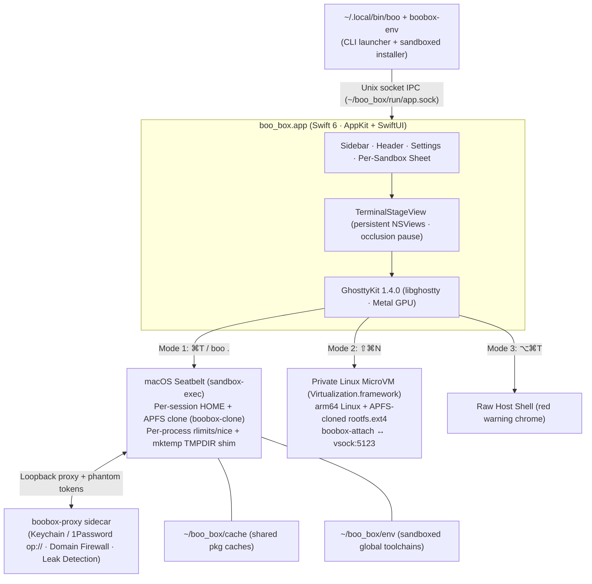

# boo_box

A native macOS terminal built on **`libghostty` (`GhosttyKit`)** where every tab runs inside an isolated sandbox — built for safely running AI coding agents and untrusted dev workflows without exposing your Mac.

---

## Why `boo_box`?

Running autonomous coding agents directly on your host shell gives them full access to `~/Desktop`, `~/Documents`, `~/.ssh`, your real git checkouts, and host API keys.

`boo_box` gives every session its own isolated sandbox while keeping native Ghostty GPU performance and zero-friction developer ergonomics:

- **Three execution modes in one terminal:**
  1. **macOS Sandbox (default, `⌘T` / `boo .`):** Kernel-enforced macOS Seatbelt (`sandbox-exec`) with a per-session `$HOME` (`~/boo_box/sessions/<id>/`) and zero-copy APFS copy-on-write repo cloning (`boobox-clone`) backed by a warm pool + Git delta sync. Agents can `rm -rf` freely without touching your real repo or host files.
  2. **Private Linux MicroVM (`⇧⌘N`):** Ephemeral Apple Silicon `arm64` Linux microVM via Apple's `Virtualization.framework` (`vmlinux-arm64` + APFS-cloned Alpine `rootfs.ext4`, 1-slot warm VM pool, multi-PTY over `vsock` via `boobox-attach`). Zero Mac filesystem access by default; wiped on close.
  3. **Raw Host Shell (`⌥⌘T`):** Explicit unsandboxed escape hatch with an unmistakable red warning header.
- **Host Secret Vault & Egress Proxy Sidecar (`boobox-proxy`):**
  - Real API keys stay **only on the host** in **macOS Keychain** or **1Password (`op://`)** — never written to `config.json` or sandbox files.
  - Sandboxes only receive worthless phantom tokens (`bbx_ph_...`) and Base-URL routes swapped at `boobox-proxy` strictly for bound hosts, with response scrubbing and active exfiltration blocking (`403 leak_blocked`).
  - Three outbound network policies (`Full (Vault Protected)`, `Dev Allowlist`, `Offline (Air-gapped)`), enforced at the kernel level via Seatbelt + direct DNS (`/var/run/mDNSResponder`) blocking.
- **Per-Sandbox Overrides (`⌥⌘,` or sidebar `…` popup):** Override network policy, Vault secret subsets, env vars, shared toolchains, host capabilities, per-process kernel `rlimit` / `nice` caps, and Private VM vCPU / RAM / NAT-or-Offline / VirtioFS `/mnt/host` shares individually per session.
- **Global Sandbox Environment (`~/boo_box/env`):** Run arbitrary install scripts (`curl … | sh`, `npm i -g`, `bun add -g`, `uv tool install`, `go install`, `cargo install`, etc.) inside Seatbelt targeting `~/boo_box/env`, with automatic executable directory discovery added to sandbox `PATH` across all sessions.
- **Fast APFS Cloning & Zero-Hang Lifecycle:**
  - `boobox-clone` uses kernel `clonefile(2)` (`0` extra SSD blocks) + warm pool + Git delta sync + `<1 ms` Unix domain socket IPC (`~/boo_box/run/app.sock`).
  - Deleting saved/active sessions and running `rm -rf <dir>` inside sandboxes (via the read-only `~/.boobox-bin/rm` shim) both use atomic APFS move-aside + detached background reaping (`<5 ms` even for 300k-file `node_modules`; opt out with `BOOBOX_SYNC_RM=1`).

---

## Architecture



### Components

| Component | Path | Responsibility |
|---|---|---|
| `boo_box` | `Sources/BooBox/` | Native macOS Swift 6 / AppKit + SwiftUI terminal embedding `GhosttyKit 1.4.0`, managing Seatbelt sessions, Private VMs, Vault, and IPC |
| `boobox-clone` | `Sources/BooBoxClone/` | Zero-copy APFS `clonefile(2)` project cloner, lock-free warm-pool popper, Git delta sync, and Unix socket IPC client |
| `boobox-proxy` | `Sources/BooBoxProxy/` | Host-side HTTP/CONNECT egress firewall, per-session policy engine, Base-URL phantom-token injector, SSE streamer, and exfiltration blocker |
| `boobox-attach` | `Sources/BooBoxAttach/` | Lightweight PTY ↔ Unix-socket ↔ guest `vsock` multiplexer for Private Linux MicroVMs |
| `sbox-init` | `guest/sbox-init.c` | Minimal static PID 1 vsock PTY daemon running inside the Alpine Linux microVM |
| `boo` / `boobox-env` | `scripts/boo`, `scripts/boobox-env` | CLI session launcher and sandboxed global environment installer |

---

## Requirements

- **Apple Silicon Mac** running **macOS 15+**
- **Swift 6** (Xcode or Apple Command Line Tools)
- **Ghostty.app** installed at `/Applications/Ghostty.app` (for bundled `terminfo` and shell integration assets copied by `bundle-app.sh`)
- **Docker** *(optional, build-time only)* if you want to build the Private Linux MicroVM guest assets (`Resources/vm/vmlinux-arm64` and `Resources/vm/rootfs.ext4`)

---

## Build & Install

```bash
git clone https://github.com/apguan/boo_box.git
cd boo_box

# Optional: build the arm64 Linux microVM kernel + Alpine rootfs for Private VM mode (⇧⌘N)
./scripts/build-guest-image.sh

# Build release boo_box.app, sign with Virtualization.framework entitlement, and install `~/.local/bin/boo`
./scripts/bundle-app.sh release

# Launch boo_box
open build/boo_box.app
```

Make sure `~/.local/bin` is on your host shell `PATH` to use the `boo` CLI from anywhere.

---

## CLI Usage (`boo`)

```bash
# Open a zero-copy APFS sandbox clone of the current project (all files incl. node_modules, 0 extra SSD bytes)
boo
boo .
boo /path/to/repo

# Clone options
boo --no-env .            # Exclude .env / .env.* secret files (keeps .env.example)
boo --slim .              # Skip node_modules & gitignored build caches
boo --full .              # Clone all files (default)
boo --scratch             # Open an empty scratch sandbox session

# Global Sandbox Environment (~/boo_box/env — shared across all sandboxes)
boo env run '<script>'    # Run any install script inside Seatbelt with HOME=~/boo_box/env
boo env shell             # Open an interactive sandboxed shell targeting ~/boo_box/env
boo tools [--json]        # List auto-discovered toolchain directories & binaries
boo env rm <dir-path>     # Remove a toolchain directory inside ~/boo_box/env
boo env reset             # Wipe and recreate ~/boo_box/env cleanly
```

---

## Keyboard Shortcuts

| Shortcut | Action |
|---|---|
| `⌘T` | New macOS Sandbox session |
| `⇧⌘O` | Open host folder in isolated APFS sandbox |
| `⇧⌘N` | New Private Linux MicroVM |
| `⌥⌘T` | New Raw Host Shell (unsandboxed) |
| `⌥⌘,` | Configure active sandbox overrides |
| `⌘,` | Global `boo_box` Settings |
| `⌘D` / `⇧⌘D` | Split pane right / down |
| `⌥⌘[` / `⌥⌘]` | Previous / next split pane |
| `⌘1`–`⌘9` | Jump to open session |
| `⌘B` / `⌥⌘S` | Toggle sidebar / flip sidebar Left ↔ Right |
| `⇧⌘E` / `⇧⌘F` | Rename active session / search sessions |
| `⇧⌘K` | Reset Private VM to clean state |
| `⌘W` / `⇧⌘W` | Close pane / close session tab (keeps non-empty macOS sandboxes in `PAST`) |

---

## Security Model

- **macOS Sandbox (`sandbox-exec`):** Default-denies reads, existence checks, and writes across `/Users`, `/private/tmp`, `/private/var/folders`, and `/Volumes`, allowing writes strictly inside the session directory (`~/boo_box/sessions/<id>/`), configured package caches (`~/boo_box/cache`), `~/boo_box/env`, and opted-in CLI configs. Host toolchains (`/opt/homebrew`, `/usr/bin`, etc.) are strictly read-only.
- **Host Secret Vault (`boobox-proxy`):** Real secret values live in macOS Keychain (`dev.boo-box.secrets`) or 1Password (`op://`) and are pushed to `boobox-proxy` over a `0600` Unix socket (`~/boo_box/run/proxy-ctl.sock`). Sandboxes only see `bbx_ph_...` phantom tokens; sending a phantom token to an unauthorized host or from an unauthorized session is blocked (`403`) and logged.
- **Terminal Escape Hardening:** `clipboard-read = ask` is enforced via Ghostty's managed override; clicking `http(s)` links in sandboxed tabs displays a dismissible prompt (and non-web URL schemes always confirm before launching external macOS handlers).
- **Private Linux MicroVM:** Hardware-virtualized via Apple `Virtualization.framework` with no host filesystem mounts by default and optional `Offline` mode (omits the virtual NIC completely).
